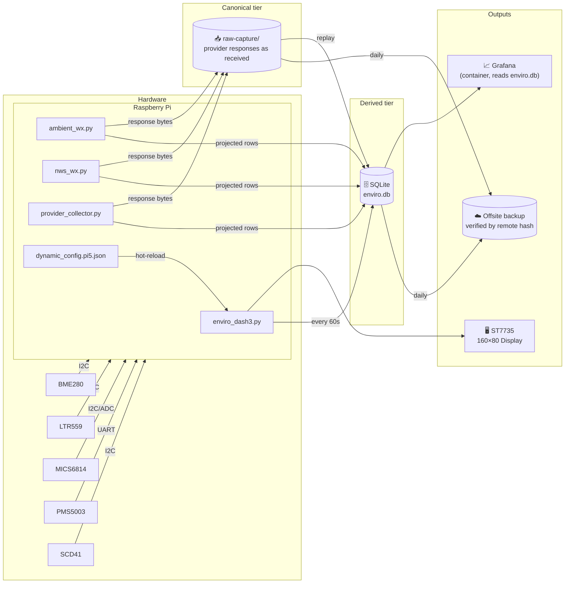

# 🌡️ Enviro+ Dashboard

A high-density, real-time air quality and environment monitor running on a Raspberry Pi with a [Pimoroni Enviro+](https://github.com/pimoroni/enviroplus-python) HAT. Five pages on the 160×80 ST7735 screen (indoor air, particulates, outdoor weather, gas, CO₂), changed by a wave over the proximity sensor, with persistent SQLite logging.

---

## 🖥️ Display Pages

`enviro_screens.py` draws each page; a hand over the LTR559 proximity sensor moves to the next one. Corner dots show which page is on.

| Page | Shows |
|------|-------|
| 1 · Glance | EPA AQI gauge (2024 PM2.5 table); indoor °F, humidity, pressure; outdoor °F and humidity from the Ambient station with trend |
| 2 · Air | PM1, PM2.5, PM10 in µg/m³ with trend lines on one shared scale |
| 3 · Outside | Wind direction, speed and gust; UV; daily rain (Ambient station) |
| 4 · Gas | Oxidising, reducing, NH3 sensor resistance in kΩ with trends |

A missing or failed reading shows `--` and leaves a gap in its trend; it is never drawn as zero. Outdoor values older than `display.outdoor_stale_s` show `--`.

**Color coding:** the AQI gauge and PM2.5 value use the EPA category colors (Good green, Moderate yellow, Unhealthy for Sensitive Groups orange, Unhealthy red, Very Unhealthy purple, Hazardous maroon). Indoor temperature, humidity and gas values use the green/yellow/orange (gas: red) bands in `thresholds`.

---

## 🔬 Sensors

| Sensor | Chip | Measures | Notes |
|--------|------|----------|-------|
| Temperature | BME280 | °F (self-heat compensated) | Constant offset `calibration.self_heat_offset_c` in the CONFIG_PATH document |
| Humidity | BME280 | % RH | |
| Pressure | BME280 | hPa | |
| Light | LTR559 | Lux | Also used as proximity sensor |
| Oxidising gas | MICS6814 | kΩ (NO₂, O₃) | Higher resistance = cleaner air |
| Reducing gas | MICS6814 | kΩ (CO, VOCs) | Lower resistance = more pollution |
| Ammonia | MICS6814 | kΩ (NH₃) | Lower resistance = more pollution |
| PM1.0 | PMS5003 | µg/m³ | External particulate sensor |
| PM2.5 | PMS5003 | µg/m³ | Fine particles — primary AQI metric |
| PM10 | PMS5003 | µg/m³ | Coarse particles |
| CO₂ | SCD41 | ppm | Adafruit breakout, I2C 0x62; photoacoustic NDIR, one sample per 5 s, BME280 pressure compensation |
| Temperature, humidity | SCD41 | °C, % RH | Stored as the sensor reports them (factory 4 °C offset); the indoor temperature and humidity on screen and in Grafana |

---

## 🏗️ Architecture



---

## 📦 Hardware

| Component | Where to buy |
|-----------|-------------|
| [Pimoroni Enviro+](https://shop.pimoroni.com/products/enviro-plus) | Pimoroni |
| [PMS5003 Particulate Sensor](https://shop.pimoroni.com/products/pms5003-particulate-matter-sensor-with-cable) | Pimoroni |
| Raspberry Pi (3 B+, 4, 5, or Zero 2 W) | Various |
| [Adafruit SCD-41 CO₂ Sensor](https://www.adafruit.com/product/5190) | Adafruit |

---

## 🚀 Setup

### 1. Install Pimoroni libraries

```bash
git clone https://github.com/pimoroni/enviroplus-python
cd enviroplus-python
./install.sh
```

### 2. Clone this repo

```bash
git clone https://github.com/strommy76/enviroplus.git ~/projects/enviroplus
cd ~/projects/enviroplus
```

### 3. Install Python dependencies

```bash
pip install -r requirements.txt
```

### 4. Configure

```bash
cp .env.example .env   # add credentials — secrets only, no tuning values here
```

| Variable | Description |
|----------|-------------|
| `SQLITE_PATH` | Path to SQLite database |
| `CONFIG_PATH` | Path to the dashboard config document (`dynamic_config.pi5.json`) |
| `NWS_API_BASE_URL` | NWS API base URL |
| `NWS_STATIONS` | Ordered NWS station identifiers; first fresh observation wins |
| `NWS_USER_AGENT` | NWS-required caller identification |
| `NWS_POLL_S` | NWS poll interval in seconds |
| `NWS_SHUTDOWN_CHECK_S` | NWS service shutdown check cadence in seconds |
| `NWS_MAX_OBSERVATION_AGE_S` | Maximum accepted NWS latest-observation age in seconds |
| `NWS_COLLECTION_LOOKBACK_S` | Bounded NWS observations query window in seconds |

All tuning values (calibration, thresholds, intervals, display) live in the CONFIG_PATH document — see below.

### 5. Run as a systemd service

```bash
sudo systemctl link "$PWD/enviro_dash.service"
sudo systemctl enable --now enviro_dash
```

Check status:
```bash
sudo systemctl status enviro_dash
journalctl -u enviro_dash -f        # or tail -f enviro_dash.log; each service has its own <service>.log
```

Before using this deployment example, reconcile the unit's device bindings and
operations-alert template with the target host. Repository content does not select
the active hardware unit; prove that binding from the running service manager as
required by PROJECT-CONFIG.md. Preserve and compare an existing copied unit as
described in [the repair plan](docs/display-spi-repair.md). For the repaired display,
GPIO9 is DC; pi-config owns the `spi0-2cs,no_miso` firmware binding that frees it.

---

## ⚙️ Dashboard config (CONFIG_PATH)

All tunable runtime values live here. The running script watches this file and **hot-reloads within 2 seconds** of any change — no restart needed.

```json
{
  "calibration": {
    "self_heat_offset_c": 6.35,  ← measured BME280 self-heat (see its provenance key)
    "bme_samples":  3             ← BME280 readings averaged per loop (reduces noise)
  },
  "intervals": {
    "publish_s":        60,  ← length of the interval each readings row covers
    "display_refresh_s": 2   ← display update rate
  },
  "thresholds": { ... },     ← color bands for temperature, humidity, gas and CO₂
  "display":    { ... }      ← proximity tap level, outdoor staleness
}
```

**To recalibrate temperature:** re-measure the offset against a reference over 5-minute means and update `self_heat_offset_c`; its `self_heat_offset_provenance` records how the current value was measured. Then rebuild the affected days with `python local_sensors.py --replay DAY...`.

---

## 🌡️ Temperature Compensation

The BME280 sits close to the Pi's CPU and reads high. On this Pi 5 with M.2 spacing the error is a near-constant pedestal, so the derived `temp_f` subtracts a measured constant, `calibration.self_heat_offset_c`, and `humidity` is corrected for the same self-heating with the Magnus formula. The SCD41, mounted clear of the Pi, supplies the indoor temperature and humidity on screen; both sensors are recorded.

---

## 🗃️ Data tiers

| Store | Tier | Contents |
|-------|------|----------|
| `raw-capture/local_sensors/<day>.ndjson` | 1, canonical | Every loop's reads, each as its driver returned it; a failed read is recorded as that lane's error |
| `readings` (SQLite) | 2, derived | One row per publish interval, projected by `local_sensors.derive_row` with the config's calibration |

Live and `local_sensors.py --replay DAY...` use the same projection, so a calibration change is applied to past days by replaying them. A row is keyed by its interval's start (rows from before Tier 1 are keyed by their write time), and replaying a day rewrites that day's rows from its first Tier 1 read onward, on the current `publish_s` grid. Replay a day once it has ended. Rows from before the first `local_sensors` record have no Tier 1 reads: they are kept as written and never rebuilt, dropped or overwritten. Live and replay differ only around a process restart: live never writes the interval open at shutdown and writes the one open at restart from its post-restart reads; replay writes both from all their reads.

---

## 📝 Data notes

Known-bad spans in the authoritative `readings` table. Rows are kept as written; these notes are how a reader knows to discount them.

| Span (UTC) | Columns | Issue |
|------------|---------|-------|
| 2026-07-30 → 2026-08-05 | `pm1`, `pm25`, `pm10` | ~85,000 PMS5003 read timeouts; the code of the time re-stored the last good values as fresh, so PM in this span is largely repeats. Fixed 2026-10-11 (failed reads now store NULL). |
| 2026-09-17 00:26 → 2026-10-11 12:48 | all | No rows: the dashboard could not start after kernel 6.18.50 claimed GPIO9 (fixed by pi-config `spi0-2cs,no_miso`). |

---

## 🗄️ SQLite Schema

```sql
CREATE TABLE readings (
    ts          TEXT PRIMARY KEY,   -- UTC: "2026-03-15 21:30:00"; interval start (write time before Tier 1)
    temp_f      REAL,
    humidity    REAL,
    pressure    REAL,
    lux         REAL,
    oxidising   REAL,
    reducing    REAL,
    ammonia     REAL,
    pm1         REAL,
    pm25        REAL,
    pm10        REAL,
    cpu_temp_c  REAL,               -- Pi CPU temperature (°C)
    cpu_load    REAL,               -- 1-minute load average
    mem_free_mb REAL,               -- available memory (MB)
    uptime_s    INTEGER,            -- system uptime (seconds)
    co2_ppm     REAL,               -- SCD41 CO2 (ppm); NULL when no sample that interval
    scd41_temp_c REAL,              -- SCD41 temperature (°C), as reported
    scd41_rh    REAL                -- SCD41 relative humidity (%), as reported
);
```

Query example — correlate CPU temp with sensor drift:
```sql
SELECT ts, temp_f, cpu_temp_c, cpu_load
FROM readings
WHERE ts >= '2026-03-15 22:00:00'
ORDER BY ts;
```

---

---

## 🔗 Upstream Sources

| Resource | Link |
|----------|------|
| Pimoroni Enviro+ Python library | https://github.com/pimoroni/enviroplus-python |
| PMS5003 Python library | https://github.com/pimoroni/pms5003-python |
| LTR559 Python library | https://github.com/pimoroni/ltr559-python |
| Pimoroni Enviro+ product page | https://shop.pimoroni.com/products/enviro-plus |
| Pimoroni learning: Enviro+ | https://learn.pimoroni.com/article/getting-started-with-enviro-plus |
| MICS6814 datasheet | https://www.sgxsensortech.com/content/uploads/2015/02/1143_Datasheet-MiCS-6814-rev-8.pdf |
| PMS5003 datasheet | https://www.aqmd.gov/docs/default-source/aq-spec/resources-page/plantower-pms5003-manual_v2-3.pdf |
| Adafruit SCD-41 guide | https://learn.adafruit.com/adafruit-scd-40-and-scd-41 |
| Sensirion SCD4x Python driver | https://github.com/Sensirion/python-i2c-scd4x |
| UBA indoor CO₂ guide values (CO₂ display bands) | Bundesgesundheitsblatt 2008, 51:1358–1369 |

---

## 📋 Roadmap

- [x] 10-sensor dashboard on ST7735 display
- [x] CPU temperature compensation (constant self-heat offset since 2026-07-30)
- [x] SQLite logging with UTC timestamps + Pi telemetry
- [x] Rotating log file
- [x] systemd service with auto-restart
- [x] Hot-reloadable dashboard config, single source of truth
- [x] BME280 averaging for noise reduction
- [x] Every local sensor read retained in Tier 1; `readings` derived and replayable
- [ ] Ruff linting with pre-commit hook (referee not installed)
- [x] Adafruit SCD-41 CO₂ sensor integration
- [ ] Grafana dashboard on AI host via Tailscale
- [ ] Migrate to Raspberry Pi 5
